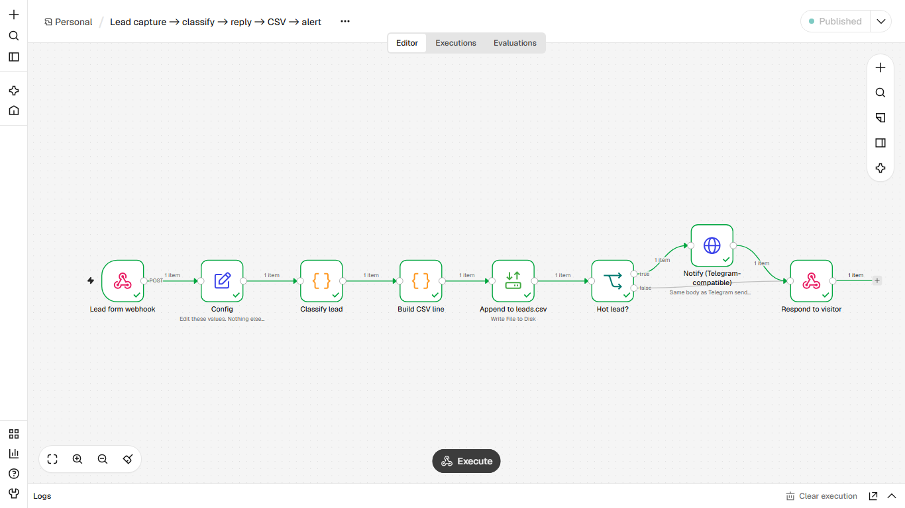
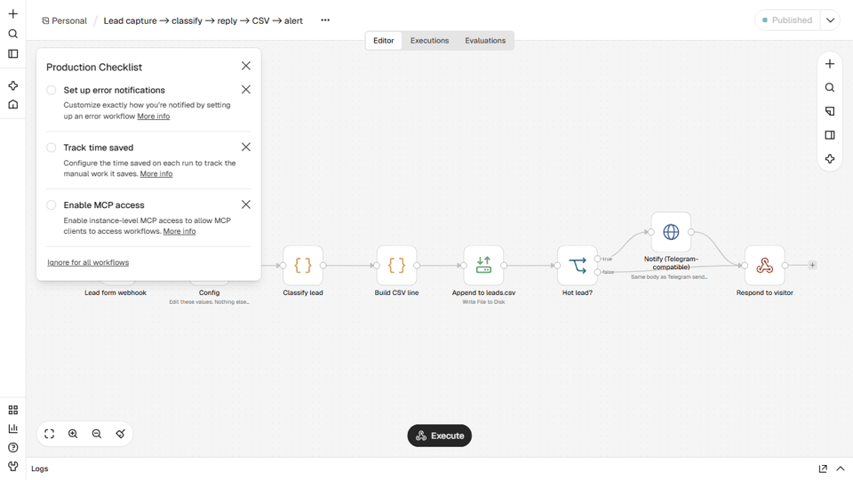

# Lead capture, classification and instant reply
**Captura de lead, classificação e resposta automática**

## EN
**Problem.** A small business gets form leads and answers hours later; hot leads go cold and nobody keeps a record.

**How it works.** Webhook receives the form, rule-based scoring (budget, urgency, buying intent, company) sets hot / warm / cold / spam, an auto-reply is written in EN or PT, a row is appended to leads.csv, and a Telegram alert fires only for hot leads. An invalid e-mail fails loudly. Spam gets no reply.

**Nodes.** Webhook, Set, Code, Read/Write Files, IF, HTTP Request, Respond to Webhook

**Import and run.** n8n, Workflows, Import from file, `workflow.json`. Edit the `Config` node (paths, `notify_url`, `notify_chat_id`). Start n8n from the folder that contains `data/` and set `N8N_RESTRICT_FILE_ACCESS_TO` to that `data` folder. Publish the workflow, then `curl -X POST http://localhost:5678/webhook/lead-capture -H "Content-Type: application/json" -d <one object from sample_input/leads.json>`. In the editor, click Execute and use the /webhook-test/ URL.

**Telegram.** `notify_url` defaults to a local mock. To go live use `https://api.telegram.org/bot<YOUR_TOKEN>/sendMessage` and your `chat_id`. No credentials are stored in the JSON.

**Proof.** `example_output/` holds the files and messages from a real end-to-end run on n8n 2.47.3.

## PT
**Problema.** Um pequeno negócio recebe leads do formulário e responde horas depois; o lead quente esfria e ninguém registra nada.

**Como funciona.** O webhook recebe o formulário, a pontuação por regras (orçamento, urgência, intenção de compra, empresa) define quente / morno / frio / spam, a resposta automática sai em PT ou EN, a linha vai para o leads.csv e o alerta no Telegram dispara só para lead quente. E-mail inválido gera erro visível. Spam não recebe resposta.

**Nós usados.** Webhook, Set, Code, Read/Write Files, IF, HTTP Request, Respond to Webhook

**Importar.** n8n, Workflows, Import from file, `workflow.json`. Edite o nó `Config` (caminhos, `notify_url`, `notify_chat_id`). Inicie o n8n na pasta que contém `data/` e aponte `N8N_RESTRICT_FILE_ACCESS_TO` para ela. Telegram real: `https://api.telegram.org/bot<SEU_TOKEN>/sendMessage`. Nenhuma credencial fica no JSON.
