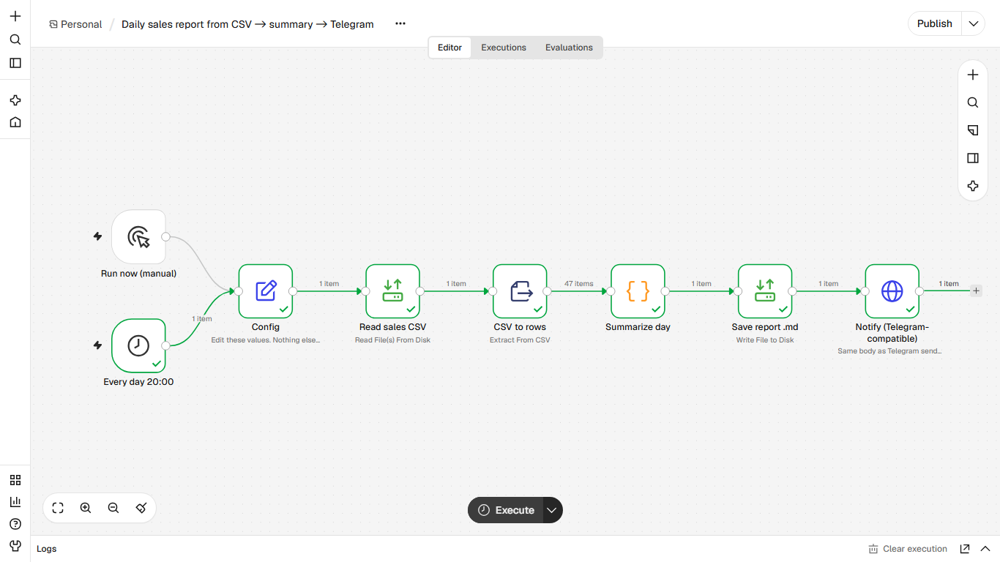
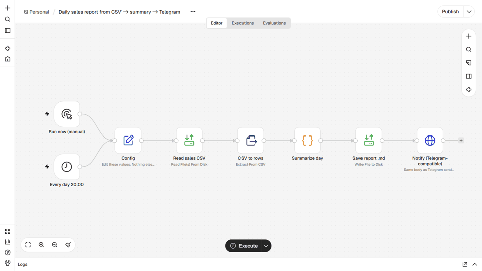

# Daily sales report from a CSV
**Relatório diário de vendas a partir de CSV**

## EN
**Problem.** The owner closes the day without knowing revenue, top products or how it compares with yesterday.

**How it works.** Schedule (20:00) or manual run reads the sales CSV (fictional data, columns shaped like an ERP export), computes total, average ticket, change vs the previous day, top products, payment mix and per-store totals, saves report_<date>.md and sends the short summary to Telegram.

**Nodes.** Schedule Trigger, Manual Trigger, Set, Read/Write Files, Extract From File, Code, HTTP Request

**Import and run.** n8n, Workflows, Import from file, `workflow.json`. Edit the `Config` node (paths, `notify_url`, `notify_chat_id`). Start n8n from the folder that contains `data/` and set `N8N_RESTRICT_FILE_ACCESS_TO` to that `data` folder. Click Execute workflow. Data: `data/sample_sales.csv` (47 fictional rows).

**Telegram.** `notify_url` defaults to a local mock. To go live use `https://api.telegram.org/bot<YOUR_TOKEN>/sendMessage` and your `chat_id`. No credentials are stored in the JSON.

**Proof.** `example_output/` holds the files and messages from a real end-to-end run on n8n 2.47.3.

## PT
**Problema.** O dono fecha o dia sem saber faturamento, produtos mais vendidos e a comparação com ontem.

**Como funciona.** Agenda (20h) ou execução manual lê o CSV de vendas (dados fictícios, colunas no formato de exportação de ERP), calcula total, ticket médio, variação vs dia anterior, top produtos, formas de pagamento e total por loja, grava report_<data>.md e envia o resumo ao Telegram.

**Nós usados.** Schedule Trigger, Manual Trigger, Set, Read/Write Files, Extract From File, Code, HTTP Request

**Importar.** n8n, Workflows, Import from file, `workflow.json`. Edite o nó `Config` (caminhos, `notify_url`, `notify_chat_id`). Inicie o n8n na pasta que contém `data/` e aponte `N8N_RESTRICT_FILE_ACCESS_TO` para ela. Telegram real: `https://api.telegram.org/bot<SEU_TOKEN>/sendMessage`. Nenhuma credencial fica no JSON.
