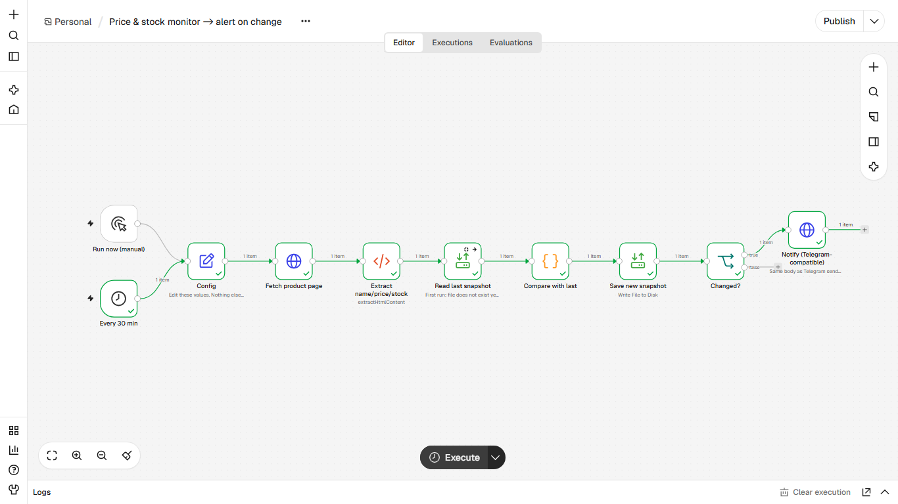
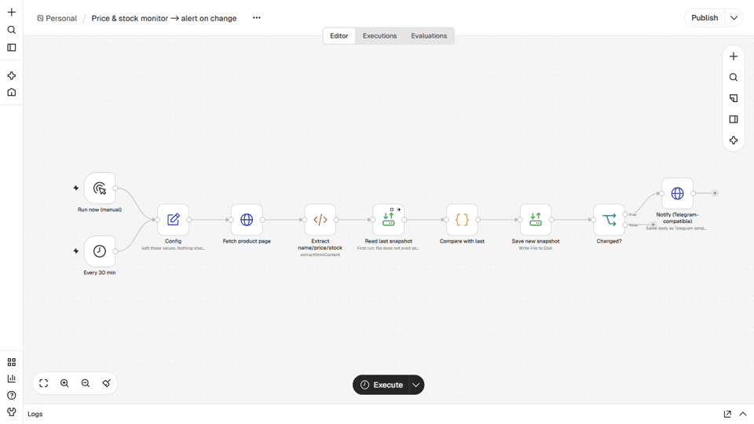

# Price and stock monitor
**Monitor de preço e estoque**

## EN
**Problem.** Checking competitor or supplier pages by hand is slow; price drops and sold-out items are noticed late.

**How it works.** Every 30 min it fetches the page, extracts name/price/stock with CSS selectors, compares with the last snapshot file and alerts only when something changed (DROP / rise / SOLD OUT / BACK IN STOCK), then saves the new snapshot. The first run only sets the baseline. The demo target is a local mock shop page; point watch_url to a page you are allowed to read and adjust the selectors.

**Nodes.** Schedule Trigger, Manual Trigger, Set, HTTP Request, HTML, Read/Write Files (continue on error), Code, IF

**Import and run.** n8n, Workflows, Import from file, `workflow.json`. Edit the `Config` node (paths, `notify_url`, `notify_chat_id`). Start n8n from the folder that contains `data/` and set `N8N_RESTRICT_FILE_ACCESS_TO` to that `data` folder. Run `python _demo/mock_server.py`, click Execute workflow, change the price in the mock shop, click Execute again.

**Telegram.** `notify_url` defaults to a local mock. To go live use `https://api.telegram.org/bot<YOUR_TOKEN>/sendMessage` and your `chat_id`. No credentials are stored in the JSON.

**Proof.** `example_output/` holds the files and messages from a real end-to-end run on n8n 2.47.3.

## PT
**Problema.** Conferir páginas de concorrente ou fornecedor na mão é lento; queda de preço e falta de estoque são percebidas tarde.

**Como funciona.** A cada 30 min busca a página, extrai nome/preço/estoque por seletores CSS, compara com o último snapshot e alerta só se algo mudou (QUEDA / alta / ESGOTADO / VOLTOU), depois grava o novo snapshot. A primeira execução só cria a base. O alvo da demo é uma loja simulada local; aponte watch_url para uma página que você pode ler e ajuste os seletores.

**Nós usados.** Schedule Trigger, Manual Trigger, Set, HTTP Request, HTML, Read/Write Files (continue on error), Code, IF

**Importar.** n8n, Workflows, Import from file, `workflow.json`. Edite o nó `Config` (caminhos, `notify_url`, `notify_chat_id`). Inicie o n8n na pasta que contém `data/` e aponte `N8N_RESTRICT_FILE_ACCESS_TO` para ela. Telegram real: `https://api.telegram.org/bot<SEU_TOKEN>/sendMessage`. Nenhuma credencial fica no JSON.
