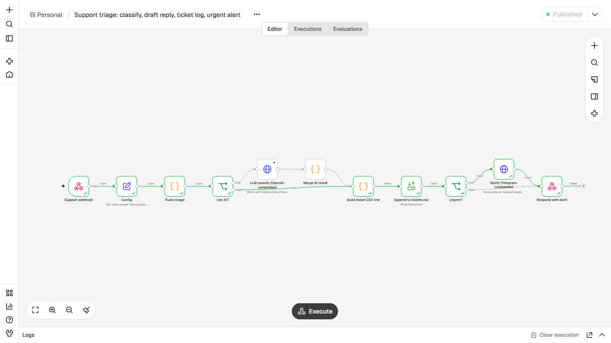
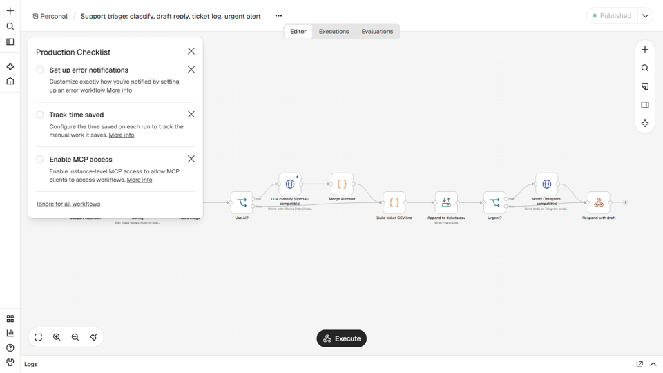

# Support message triage with optional AI
**Triagem de mensagens de suporte com IA opcional**

## EN
**Problem.** The support inbox mixes billing, bugs and sales questions; urgent ones wait in line and every reply is typed from scratch.

**How it works.** Webhook receives the message; rules classify category (billing / bug / sales / question / other), urgency and sentiment and write a draft reply in the sender language. Optional LLM step (Config use_ai=true, any OpenAI-compatible endpoint such as local Ollama); if the model fails or answers badly the ticket is marked rules-fallback with the reason. A row goes to tickets.csv, urgent tickets alert Telegram, and the draft is returned in the response. Default is rules only; the AI branch was tested against a local mock endpoint, not a real model.

**Nodes.** Webhook, Set, Code, IF, HTTP Request (LLM), Read/Write Files, Respond to Webhook

**Import and run.** n8n, Workflows, Import from file, `workflow.json`. Edit the `Config` node (paths, `notify_url`, `notify_chat_id`). Start n8n from the folder that contains `data/` and set `N8N_RESTRICT_FILE_ACCESS_TO` to that `data` folder. Publish, then `curl -X POST http://localhost:5678/webhook/support-triage -H "Content-Type: application/json" -d <one object from sample_input/messages.json>`.

**Telegram.** `notify_url` defaults to a local mock. To go live use `https://api.telegram.org/bot<YOUR_TOKEN>/sendMessage` and your `chat_id`. No credentials are stored in the JSON.

**Proof.** `example_output/` holds the files and messages from a real end-to-end run on n8n 2.47.3.

## PT
**Problema.** A caixa de suporte mistura cobrança, bug e dúvida comercial; o urgente espera na fila e cada resposta é digitada do zero.

**Como funciona.** O webhook recebe a mensagem; regras classificam categoria (cobrança / bug / vendas / dúvida / outro), urgência e sentimento e escrevem um rascunho de resposta no idioma do cliente. Etapa opcional de LLM (Config use_ai=true, qualquer endpoint compatível com OpenAI, como Ollama local); se o modelo falhar ou responder mal, o ticket é marcado rules-fallback com o motivo. A linha vai para tickets.csv, ticket urgente avisa no Telegram e o rascunho volta na resposta. O padrão é só regras; o ramo de IA foi testado contra um endpoint simulado local, não contra um modelo real.

**Nós usados.** Webhook, Set, Code, IF, HTTP Request (LLM), Read/Write Files, Respond to Webhook

**Importar.** n8n, Workflows, Import from file, `workflow.json`. Edite o nó `Config` (caminhos, `notify_url`, `notify_chat_id`). Inicie o n8n na pasta que contém `data/` e aponte `N8N_RESTRICT_FILE_ACCESS_TO` para ela. Telegram real: `https://api.telegram.org/bot<SEU_TOKEN>/sendMessage`. Nenhuma credencial fica no JSON.
