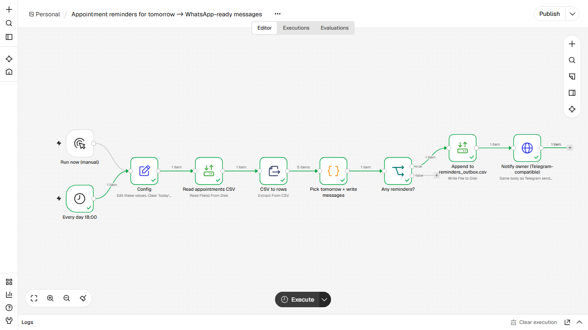
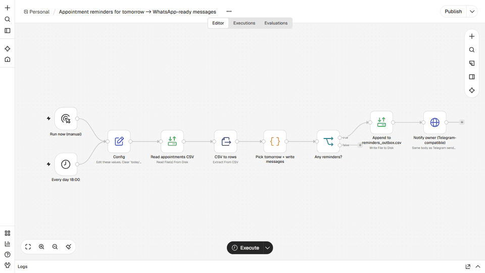

# Appointment reminders for a salon or clinic
**Lembretes de agendamento para salão ou clínica**

## EN
**Problem.** No-shows cost a salon or clinic money; staff send reminders by hand, or forget.

**How it works.** Every day at 18:00 it reads the appointments CSV, keeps tomorrow's, builds a personalised message and a click-to-chat wa.me link per client, appends to reminders_outbox.csv and sends the owner a summary on Telegram. Messages are prepared, not sent: sending needs a WhatsApp provider you choose. Config.today is fixed to 2026-11-10 so the demo data matches; clear it to use the real date.

**Nodes.** Schedule Trigger, Manual Trigger, Set, Read/Write Files, Extract From File, Code, IF, HTTP Request

**Import and run.** n8n, Workflows, Import from file, `workflow.json`. Edit the `Config` node (paths, `notify_url`, `notify_chat_id`). Start n8n from the folder that contains `data/` and set `N8N_RESTRICT_FILE_ACCESS_TO` to that `data` folder. Click Execute workflow. Data: `data/sample_appointments.csv` (5 fictional clients).

**Telegram.** `notify_url` defaults to a local mock. To go live use `https://api.telegram.org/bot<YOUR_TOKEN>/sendMessage` and your `chat_id`. No credentials are stored in the JSON.

**Proof.** `example_output/` holds the files and messages from a real end-to-end run on n8n 2.47.3.

## PT
**Problema.** Faltas custam dinheiro a salão ou clínica; a equipe manda lembrete na mão, ou esquece.

**Como funciona.** Todo dia às 18h lê o CSV de agendamentos, filtra os de amanhã, monta mensagem personalizada e link wa.me por cliente, grava em reminders_outbox.csv e envia um resumo ao dono no Telegram. As mensagens são preparadas, não enviadas: o envio depende do provedor de WhatsApp que você escolher. Config.today está fixo em 2026-11-10 para casar com os dados da demo; apague para usar a data real.

**Nós usados.** Schedule Trigger, Manual Trigger, Set, Read/Write Files, Extract From File, Code, IF, HTTP Request

**Importar.** n8n, Workflows, Import from file, `workflow.json`. Edite o nó `Config` (caminhos, `notify_url`, `notify_chat_id`). Inicie o n8n na pasta que contém `data/` e aponte `N8N_RESTRICT_FILE_ACCESS_TO` para ela. Telegram real: `https://api.telegram.org/bot<SEU_TOKEN>/sendMessage`. Nenhuma credencial fica no JSON.
