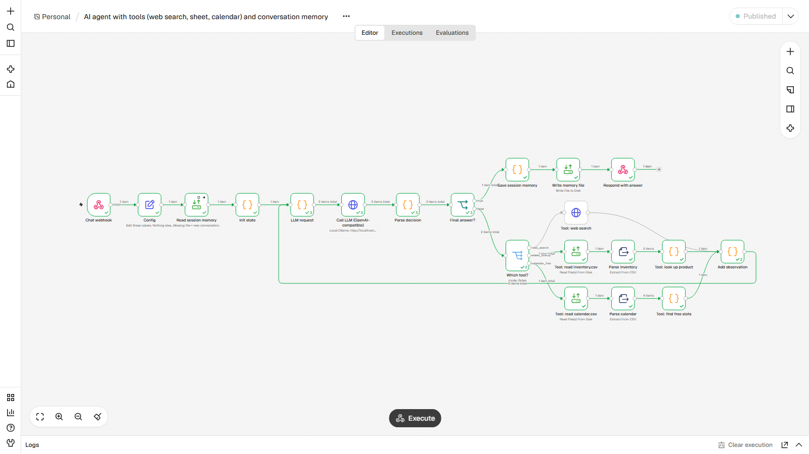
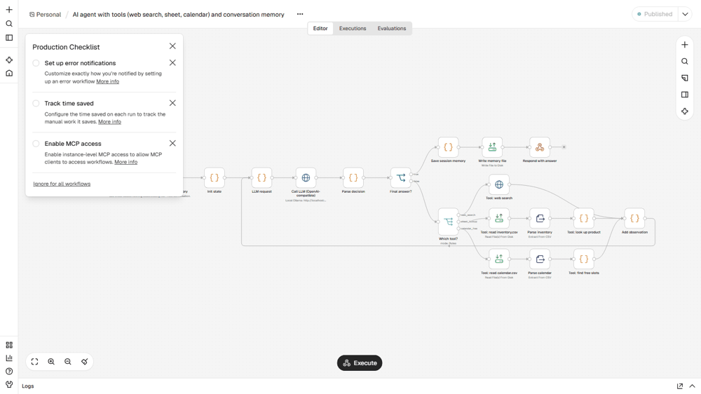

# AI agent with tools and memory (search, spreadsheet, calendar)
**Agente de IA com ferramentas e memória (busca, planilha, calendário)**

## EN
**Problem.** Staff ask the same operational questions all day: is the item in stock, what does it cost, when is someone free. Answers live in three different places.

**How it works.** A chat webhook receives a question and a session id. The workflow loads that session's memory file, asks an LLM (any OpenAI-compatible endpoint) to decide: call a tool or answer. Tools are a web-search HTTP call, an inventory CSV lookup and a calendar free-slot finder. After each tool the observation goes back to the LLM (a visible loop, capped by `max_steps`), until it returns a final answer. The memory file keeps the last turns and the last product, so "How much does it cost?" works as a follow-up. Tool calls and step count come back in the response. The demo LLM is a deterministic planner (`mock_server2.py`) so the run is reproducible; to use a real model set `llm_url` to Ollama (`http://localhost:11434/v1/chat/completions`, e.g. a 3B model) or any hosted API. Not tested against a real model.

**Nodes.** Webhook, Set, Read/Write Files, Code (agent loop), HTTP Request (LLM + search), Extract From File (CSV), IF, Switch

**Import and run.** Start n8n from the `lote2` folder (so `./data` resolves) and set `N8N_RESTRICT_FILE_ACCESS_TO` to that `data` folder. n8n, Workflows, Import from file, `workflow.json`. Edit the `Config` node if your paths or URLs differ. `curl -X POST http://localhost:5679/webhook/agent-chat -H "Content-Type: application/json" -d '{"session_id":"demo","question":"Do we have the kettle in stock, and when am I free tomorrow?"}'` (publish the workflow first). Questions in `sample_input/questions.json`.

**Proof.** `example_output/` holds files and messages from a real end-to-end run on n8n 2.47.3. Demo helpers live in `_demo/mock_server2.py` (port 8098): a Telegram-compatible endpoint, an OpenAI-compatible LLM stand-in, a search API, sample company pages and a flaky System B. Nothing leaves the machine. No credentials are stored in the JSON; `notify_url` points at a local mock and takes `https://api.telegram.org/bot<YOUR_TOKEN>/sendMessage` to go live.

## PT
**Problema.** A equipe faz as mesmas perguntas o dia todo: tem em estoque, quanto custa, quando há horário livre. As respostas ficam em três lugares diferentes.

**Como funciona.** Um webhook recebe a pergunta e um id de sessão. O fluxo carrega o arquivo de memória da sessão e pergunta a um LLM (qualquer endpoint compatível com OpenAI) se deve chamar uma ferramenta ou responder. As ferramentas são uma busca web por HTTP, uma consulta ao CSV de estoque e um localizador de horários livres. Depois de cada ferramenta a observação volta ao LLM (loop visível, limitado por `max_steps`) até haver resposta final. O arquivo de memória guarda os últimos turnos e o último produto, então "Quanto custa?" funciona como pergunta seguinte. As ferramentas usadas e o número de passos voltam na resposta. O LLM da demo é um planejador determinístico (`mock_server2.py`) para a execução ser reproduzível; para usar um modelo real aponte `llm_url` para o Ollama (`http://localhost:11434/v1/chat/completions`, ex.: modelo de 3B) ou qualquer API. Não testado com modelo real.

**Nós usados.** Webhook, Set, Read/Write Files, Code (agent loop), HTTP Request (LLM + search), Extract From File (CSV), IF, Switch

**Importar.** Inicie o n8n pela pasta `lote2` (para `./data` funcionar) e aponte `N8N_RESTRICT_FILE_ACCESS_TO` para a pasta `data`. n8n, Workflows, Import from file, `workflow.json`. Edite o nó `Config` se seus caminhos ou URLs forem outros. O comando `curl`, os dados e as entradas de exemplo estão na seção EN acima e em `sample_input/` / `data/`.

**Prova.** `example_output/` tem os arquivos e mensagens de uma execução real de ponta a ponta no n8n 2.47.3. Os auxiliares da demo ficam em `_demo/mock_server2.py` (porta 8098): endpoint compatível com Telegram, LLM simulado compatível com OpenAI, API de busca, páginas de empresas de exemplo e um Sistema B instável. Nada sai da máquina. Nenhuma credencial fica no JSON; `notify_url` aponta para um mock local e aceita `https://api.telegram.org/bot<SEU_TOKEN>/sendMessage` para ir ao ar.
