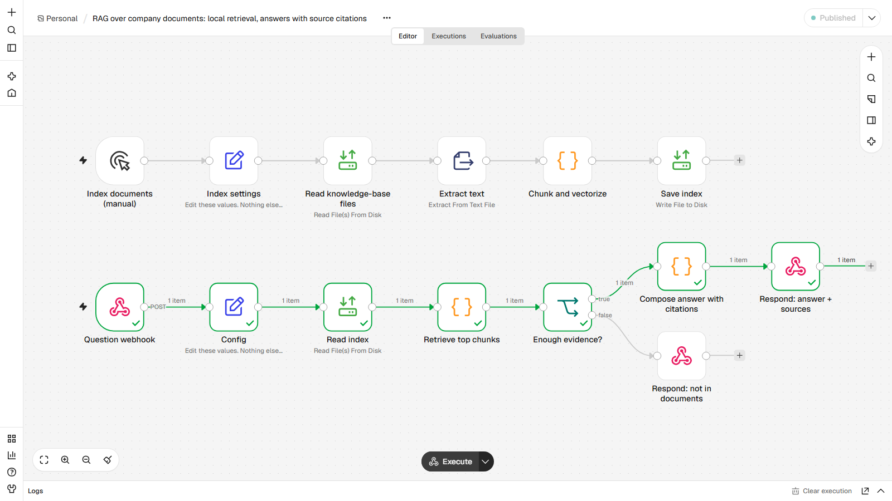
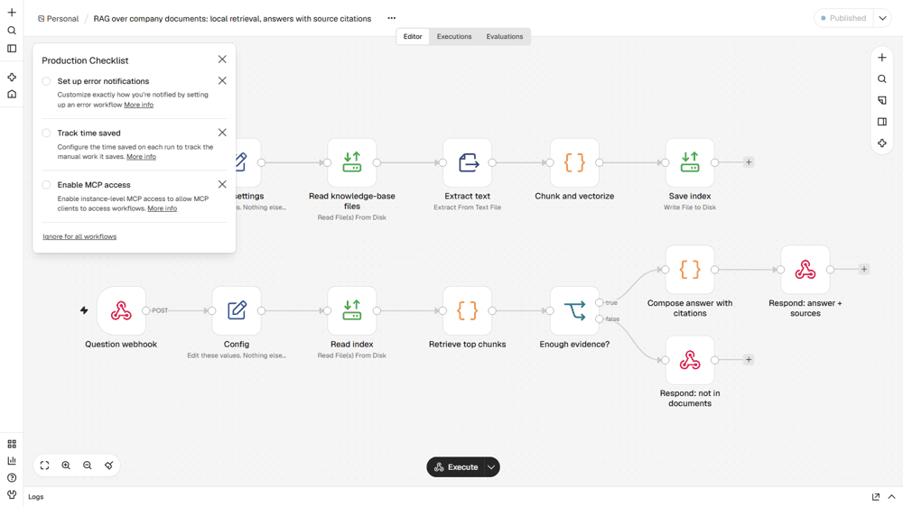

# RAG over company documents, answers with citations
**RAG sobre documentos da empresa, respostas com citação da fonte**

## EN
**Problem.** Customers and staff ask questions already answered in policy documents, and a generic chatbot invents answers.

**How it works.** Two paths. Index: reads every `.md` in `data/kb/`, splits it into 2-sentence chunks and builds TF-IDF vectors locally (no API, no cost) saved to `rag_index.json`. Ask: a webhook receives the question, vectorizes it, ranks chunks by cosine similarity, and answers only if the best score clears `min_score`. The answer is the most relevant sentences from the best chunk, with `[1]` plus a source list (file, section, paragraph, score). Below the threshold it says it could not find the answer and cites nothing, instead of guessing. Retrieval is lexical, not neural embeddings; to upgrade, replace the vectorize step with an Ollama embeddings call (`nomic-embed-text`) and keep the rest. No LLM is used to write the answer; add an HTTP Request node as in workflow 06 if you want generated prose.

**Nodes.** Manual Trigger, Webhook, Set, Read/Write Files (glob), Extract From File (text), Code (chunk, TF-IDF, cosine), IF, Respond to Webhook

**Import and run.** Start n8n from the `lote2` folder (so `./data` resolves) and set `N8N_RESTRICT_FILE_ACCESS_TO` to that `data` folder. n8n, Workflows, Import from file, `workflow.json`. Edit the `Config` node if your paths or URLs differ. Click Execute on `Index documents (manual)`, publish, then `curl -X POST http://localhost:5679/webhook/ask-docs -H "Content-Type: application/json" -d '{"question":"Is there a phone line for support?"}'`. Sample documents in `data/kb/` (fictional company).

**Proof.** `example_output/` holds files and messages from a real end-to-end run on n8n 2.47.3. Demo helpers live in `_demo/mock_server2.py` (port 8098): a Telegram-compatible endpoint, an OpenAI-compatible LLM stand-in, a search API, sample company pages and a flaky System B. Nothing leaves the machine. No credentials are stored in the JSON; `notify_url` points at a local mock and takes `https://api.telegram.org/bot<YOUR_TOKEN>/sendMessage` to go live.

## PT
**Problema.** Clientes e equipe perguntam coisas que já estão nos documentos de política, e um chatbot genérico inventa respostas.

**Como funciona.** Duas rotas. Indexar: lê todo `.md` de `data/kb/`, divide em trechos de 2 frases e monta vetores TF-IDF localmente (sem API, sem custo) salvos em `rag_index.json`. Perguntar: um webhook recebe a pergunta, vetoriza, ranqueia os trechos por similaridade de cosseno e só responde se a melhor nota passar de `min_score`. A resposta é o conjunto de frases mais relevantes do melhor trecho, com `[1]` e a lista de fontes (arquivo, seção, parágrafo, nota). Abaixo do limite ele diz que não encontrou e não cita nada, em vez de chutar. A busca é lexical, não embeddings neurais; para evoluir, troque a etapa de vetorização por uma chamada de embeddings do Ollama (`nomic-embed-text`) e mantenha o resto. Nenhum LLM escreve a resposta; adicione um nó HTTP Request como no workflow 06 se quiser texto gerado.

**Nós usados.** Manual Trigger, Webhook, Set, Read/Write Files (glob), Extract From File (text), Code (chunk, TF-IDF, cosine), IF, Respond to Webhook

**Importar.** Inicie o n8n pela pasta `lote2` (para `./data` funcionar) e aponte `N8N_RESTRICT_FILE_ACCESS_TO` para a pasta `data`. n8n, Workflows, Import from file, `workflow.json`. Edite o nó `Config` se seus caminhos ou URLs forem outros. O comando `curl`, os dados e as entradas de exemplo estão na seção EN acima e em `sample_input/` / `data/`.

**Prova.** `example_output/` tem os arquivos e mensagens de uma execução real de ponta a ponta no n8n 2.47.3. Os auxiliares da demo ficam em `_demo/mock_server2.py` (porta 8098): endpoint compatível com Telegram, LLM simulado compatível com OpenAI, API de busca, páginas de empresas de exemplo e um Sistema B instável. Nada sai da máquina. Nenhuma credencial fica no JSON; `notify_url` aponta para um mock local e aceita `https://api.telegram.org/bot<SEU_TOKEN>/sendMessage` para ir ao ar.
