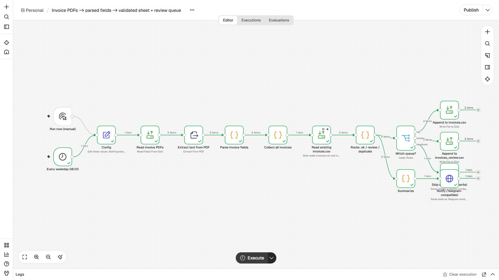
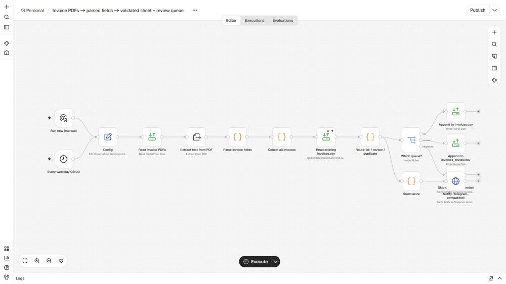

# Invoice PDFs to a validated spreadsheet with a review queue
**PDFs de nota fiscal para planilha validada, com fila de revisão**

## EN
**Problem.** Someone retypes supplier invoices into a spreadsheet; typos creep in and the same invoice gets booked twice.

**How it works.** Every weekday at 08:00 (or manually) it reads all PDFs in `data/invoices/`, extracts the text, and pulls vendor, invoice number, date, subtotal, tax, total and currency with regular expressions that accept label variants (`Invoice No`, `Invoice #`). Each invoice is validated: required fields present and subtotal + tax = total. Good ones are appended to `invoices.csv`; failures go to `invoices_review.csv` with the reason; anything already in either file (same vendor + number) is skipped, so re-running is safe. A summary goes to Telegram. Works on text-based PDFs; scanned images would need OCR first (not included).

**Nodes.** Manual Trigger, Schedule Trigger, Set, Read/Write Files (glob), Extract From File (PDF), Code, Switch, HTTP Request

**Import and run.** Start n8n from the `lote2` folder (so `./data` resolves) and set `N8N_RESTRICT_FILE_ACCESS_TO` to that `data` folder. n8n, Workflows, Import from file, `workflow.json`. Edit the `Config` node if your paths or URLs differ. Click Execute workflow. Five fictional PDFs in `data/invoices/` (generated by `_build/make_pdfs.py`): 2 clean, 1 exact duplicate, 1 with a total that does not add up, 1 with no date.

**Proof.** `example_output/` holds files and messages from a real end-to-end run on n8n 2.47.3. Demo helpers live in `_demo/mock_server2.py` (port 8098): a Telegram-compatible endpoint, an OpenAI-compatible LLM stand-in, a search API, sample company pages and a flaky System B. Nothing leaves the machine. No credentials are stored in the JSON; `notify_url` points at a local mock and takes `https://api.telegram.org/bot<YOUR_TOKEN>/sendMessage` to go live.

## PT
**Problema.** Alguém redigita notas de fornecedores numa planilha; surgem erros de digitação e a mesma nota é lançada duas vezes.

**Como funciona.** Todo dia útil às 08:00 (ou manualmente) lê todos os PDFs de `data/invoices/`, extrai o texto e captura fornecedor, número, data, subtotal, imposto, total e moeda com expressões regulares que aceitam variações de rótulo (`Invoice No`, `Invoice #`). Cada nota é validada: campos obrigatórios presentes e subtotal + imposto = total. As boas vão para `invoices.csv`; as com problema vão para `invoices_review.csv` com o motivo; o que já está em qualquer um dos arquivos (mesmo fornecedor + número) é ignorado, então rodar de novo é seguro. Um resumo vai ao Telegram. Funciona com PDF de texto; imagem escaneada precisaria de OCR antes (não incluído).

**Nós usados.** Manual Trigger, Schedule Trigger, Set, Read/Write Files (glob), Extract From File (PDF), Code, Switch, HTTP Request

**Importar.** Inicie o n8n pela pasta `lote2` (para `./data` funcionar) e aponte `N8N_RESTRICT_FILE_ACCESS_TO` para a pasta `data`. n8n, Workflows, Import from file, `workflow.json`. Edite o nó `Config` se seus caminhos ou URLs forem outros. O comando `curl`, os dados e as entradas de exemplo estão na seção EN acima e em `sample_input/` / `data/`.

**Prova.** `example_output/` tem os arquivos e mensagens de uma execução real de ponta a ponta no n8n 2.47.3. Os auxiliares da demo ficam em `_demo/mock_server2.py` (porta 8098): endpoint compatível com Telegram, LLM simulado compatível com OpenAI, API de busca, páginas de empresas de exemplo e um Sistema B instável. Nada sai da máquina. Nenhuma credencial fica no JSON; `notify_url` aponta para um mock local e aceita `https://api.telegram.org/bot<SEU_TOKEN>/sendMessage` para ir ao ar.
