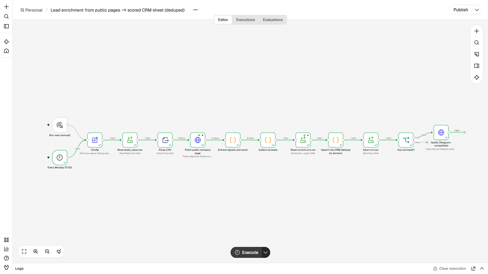
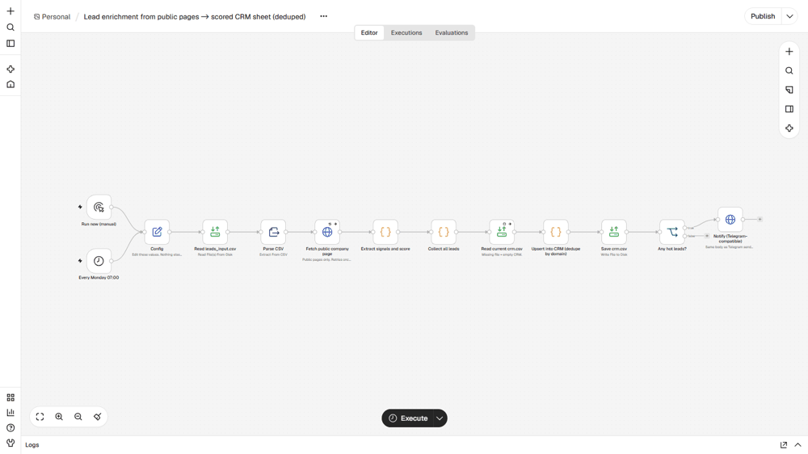

# Lead enrichment from public pages into a scored CRM sheet
**Enriquecimento de leads a partir de páginas públicas para uma planilha de CRM com pontuação**

## EN
**Problem.** A list of company names is useless to sales until someone opens each website to find size, industry and a contact.

**How it works.** Weekly (or manually) it reads `leads_input.csv`, fetches each company's public page (one retry, a 404 does not stop the run), extracts description, industry, team size, tech hints, public e-mail and phone, and scores the lead (size, contact data, hiring/funding signals, target industry). Rows are upserted into `crm.csv` by domain: new leads are added, existing ones refreshed with `first_seen` kept, unreachable sites are marked instead of dropped. Telegram gets a summary with the hot leads. The demo pages are fictional and served by the local mock; before pointing it at real sites check robots.txt and each site's terms and keep to public pages and public business contacts.

**Nodes.** Manual Trigger, Schedule Trigger, Set, Read/Write Files, Extract From File (CSV), HTTP Request (with retry), Code, IF

**Import and run.** Start n8n from the `lote2` folder (so `./data` resolves) and set `N8N_RESTRICT_FILE_ACCESS_TO` to that `data` folder. n8n, Workflows, Import from file, `workflow.json`. Edit the `Config` node if your paths or URLs differ. Click Execute workflow. Input `data/leads_input.csv` (5 fictional companies, one with a dead site). Run it twice to see the upsert: second run adds 0 and updates 5.

**Proof.** `example_output/` holds files and messages from a real end-to-end run on n8n 2.47.3. Demo helpers live in `_demo/mock_server2.py` (port 8098): a Telegram-compatible endpoint, an OpenAI-compatible LLM stand-in, a search API, sample company pages and a flaky System B. Nothing leaves the machine. No credentials are stored in the JSON; `notify_url` points at a local mock and takes `https://api.telegram.org/bot<YOUR_TOKEN>/sendMessage` to go live.

## PT
**Problema.** Uma lista de nomes de empresas não serve para vendas até alguém abrir cada site para achar porte, setor e contato.

**Como funciona.** Semanalmente (ou manualmente) lê `leads_input.csv`, busca a página pública de cada empresa (uma nova tentativa; um 404 não interrompe a execução), extrai descrição, setor, porte, tecnologia, e-mail e telefone públicos e pontua o lead (porte, dados de contato, sinais de contratação/investimento, setor-alvo). As linhas entram em `crm.csv` por domínio: leads novos são adicionados, os existentes atualizados mantendo `first_seen`, e sites fora do ar são marcados em vez de descartados. O Telegram recebe um resumo com os leads quentes. As páginas da demo são fictícias e servidas pelo mock local; antes de apontar para sites reais confira o robots.txt e os termos de cada site e use só páginas públicas e contatos comerciais públicos.

**Nós usados.** Manual Trigger, Schedule Trigger, Set, Read/Write Files, Extract From File (CSV), HTTP Request (with retry), Code, IF

**Importar.** Inicie o n8n pela pasta `lote2` (para `./data` funcionar) e aponte `N8N_RESTRICT_FILE_ACCESS_TO` para a pasta `data`. n8n, Workflows, Import from file, `workflow.json`. Edite o nó `Config` se seus caminhos ou URLs forem outros. O comando `curl`, os dados e as entradas de exemplo estão na seção EN acima e em `sample_input/` / `data/`.

**Prova.** `example_output/` tem os arquivos e mensagens de uma execução real de ponta a ponta no n8n 2.47.3. Os auxiliares da demo ficam em `_demo/mock_server2.py` (porta 8098): endpoint compatível com Telegram, LLM simulado compatível com OpenAI, API de busca, páginas de empresas de exemplo e um Sistema B instável. Nada sai da máquina. Nenhuma credencial fica no JSON; `notify_url` aponta para um mock local e aceita `https://api.telegram.org/bot<SEU_TOKEN>/sendMessage` para ir ao ar.
