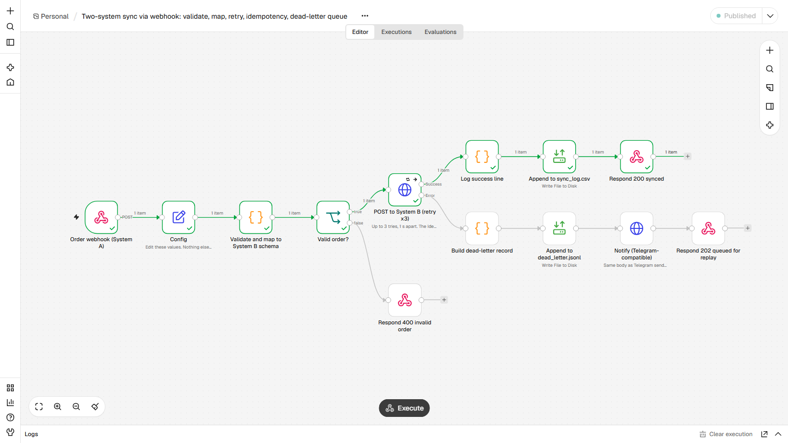
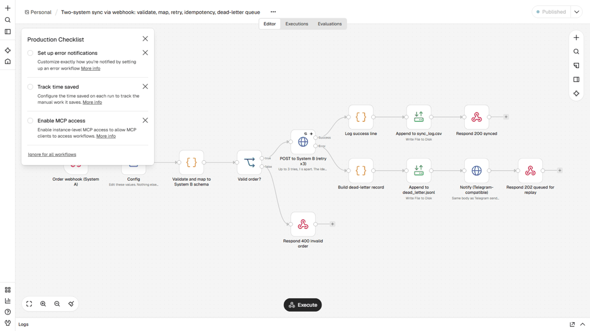

# Two-system sync via webhook: validation, retry, idempotency, dead-letter queue
**Sincronização entre dois sistemas por webhook: validação, retry, idempotência e fila de falhas**

## EN
**Problem.** Orders created in one system must appear in another. When the second system blinks, orders are lost or duplicated and nobody knows.

**How it works.** System A posts an order to the webhook. The workflow validates it (id, e-mail, items, positive total) and answers 400 with every error if invalid. Valid orders are mapped to System B's schema and posted with an `Idempotency-Key` header, with up to 3 tries 1 s apart (node-level retry). Success is logged to `sync_log.csv` and answered 200; sending the same order again returns `duplicate: true` instead of creating twice. If all tries fail, the order is written to `dead_letter.jsonl`, a Telegram alert fires, and the caller gets 202 "queued" so nothing is lost. The demo System B is a mock: ids ending in `-F` fail twice then work, ids ending in `-X` always fail. A replay step for the dead letters is not included.

**Nodes.** Webhook, Set, Code, IF, HTTP Request (retry + error output), Read/Write Files, Respond to Webhook

**Import and run.** Start n8n from the `lote2` folder (so `./data` resolves) and set `N8N_RESTRICT_FILE_ACCESS_TO` to that `data` folder. n8n, Workflows, Import from file, `workflow.json`. Edit the `Config` node if your paths or URLs differ. Publish, then post one object from `sample_input/orders.json` to `http://localhost:5679/webhook/order-sync`. Responses recorded in `example_output/responses.md`.

**Proof.** `example_output/` holds files and messages from a real end-to-end run on n8n 2.47.3. Demo helpers live in `_demo/mock_server2.py` (port 8098): a Telegram-compatible endpoint, an OpenAI-compatible LLM stand-in, a search API, sample company pages and a flaky System B. Nothing leaves the machine. No credentials are stored in the JSON; `notify_url` points at a local mock and takes `https://api.telegram.org/bot<YOUR_TOKEN>/sendMessage` to go live.

## PT
**Problema.** Pedidos criados em um sistema precisam aparecer em outro. Quando o segundo sistema falha, pedidos somem ou duplicam e ninguém percebe.

**Como funciona.** O Sistema A envia o pedido ao webhook. O fluxo valida (id, e-mail, itens, total positivo) e responde 400 com todos os erros se for inválido. Pedidos válidos são mapeados para o formato do Sistema B e enviados com o cabeçalho `Idempotency-Key`, com até 3 tentativas a 1 s de intervalo (retry no nó). Sucesso é registrado em `sync_log.csv` e responde 200; reenviar o mesmo pedido devolve `duplicate: true` em vez de criar duas vezes. Se todas as tentativas falharem, o pedido vai para `dead_letter.jsonl`, dispara alerta no Telegram e quem chamou recebe 202 "na fila", sem perder nada. O Sistema B da demo é um mock: ids terminados em `-F` falham duas vezes e depois funcionam, terminados em `-X` sempre falham. Reprocessar a fila de falhas não está incluído.

**Nós usados.** Webhook, Set, Code, IF, HTTP Request (retry + error output), Read/Write Files, Respond to Webhook

**Importar.** Inicie o n8n pela pasta `lote2` (para `./data` funcionar) e aponte `N8N_RESTRICT_FILE_ACCESS_TO` para a pasta `data`. n8n, Workflows, Import from file, `workflow.json`. Edite o nó `Config` se seus caminhos ou URLs forem outros. O comando `curl`, os dados e as entradas de exemplo estão na seção EN acima e em `sample_input/` / `data/`.

**Prova.** `example_output/` tem os arquivos e mensagens de uma execução real de ponta a ponta no n8n 2.47.3. Os auxiliares da demo ficam em `_demo/mock_server2.py` (porta 8098): endpoint compatível com Telegram, LLM simulado compatível com OpenAI, API de busca, páginas de empresas de exemplo e um Sistema B instável. Nada sai da máquina. Nenhuma credencial fica no JSON; `notify_url` aponta para um mock local e aceita `https://api.telegram.org/bot<SEU_TOKEN>/sendMessage` para ir ao ar.
