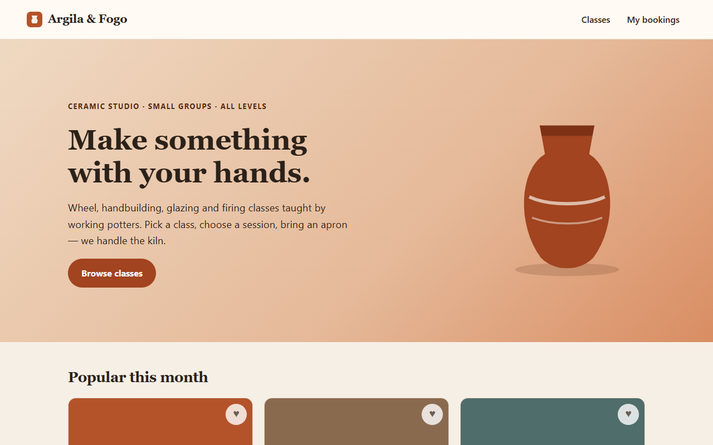
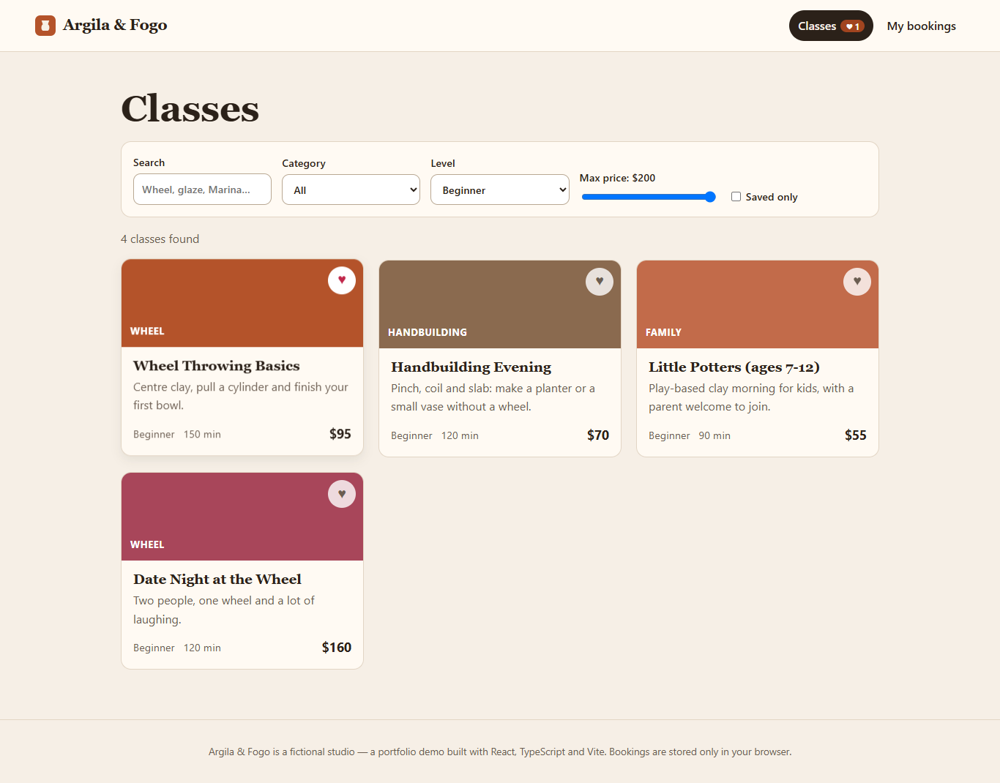
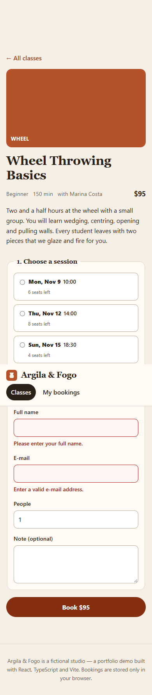

# Argila & Fogo — ceramic class booking (React demo)

A front-end portfolio project: browse classes at a **fictional** pottery studio, filter and search, save favourites, pick a session and book with a validated form. No backend — data is mock JSON and bookings live in `localStorage`.



## Stack
- React 19 + TypeScript + Vite
- React Router (`HashRouter`, so the static build works from any subfolder)
- State: Context + `useReducer`, persisted to `localStorage`
- Tests: Vitest + Testing Library (10 tests: filtering, validation, reducer, user flows)
- ESLint (typescript-eslint, react-hooks)

## Features
- Class catalogue with text search, category, level, price slider and "saved only" (filters in the URL)
- Favourites with live counter in the header
- Session picker with real seat counts that drop as you book; full sessions are disabled
- Booking form with per-field validation, `aria-invalid` / `role="alert"` messages and overbooking protection
- "My bookings" page with cancel
- Responsive, keyboard accessible, skip link, visible focus, reduced-motion support

## Screenshots
| Desktop | Mobile |
|---|---|
|  |  |

## Run it
```bash
npm install
npm run dev      # http://localhost:5173
npm test         # Vitest
npm run lint
npm run build    # static site in dist/ (relative base, deploy to any subfolder)
```
