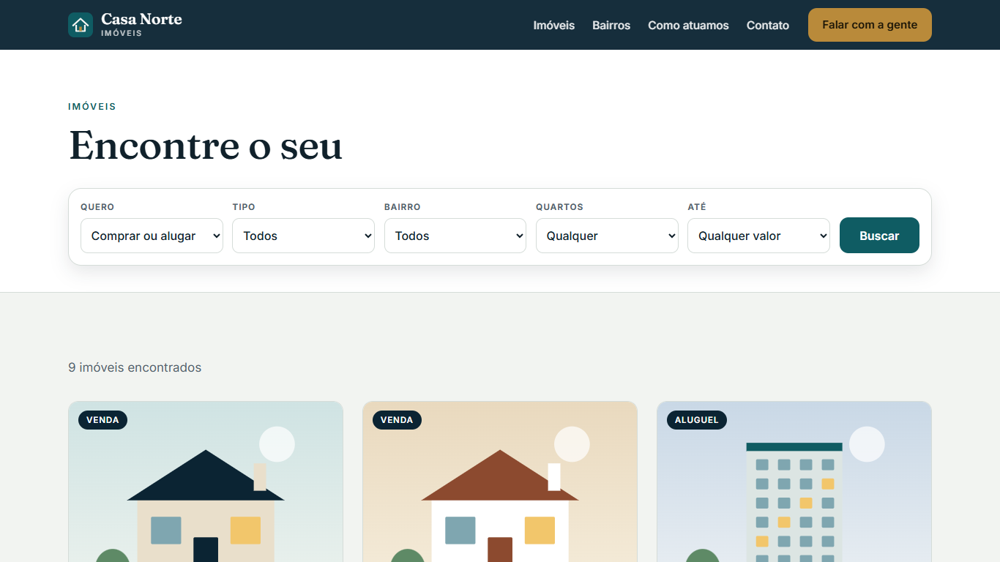
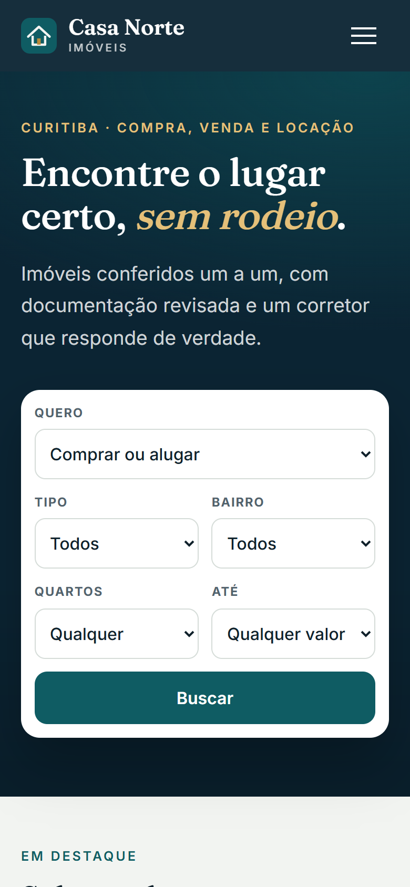

# Casa Norte Imóveis — custom WordPress theme

A hand-built WordPress theme for **Casa Norte**, a fictional real-estate agency in Curitiba, Brazil. No page builder, no starter theme, no plugins required.


| Listings with filters | Mobile |
|---|---|
|  |  |

## What's inside

- **Classic PHP theme**: `header.php`, `footer.php`, `front-page.php`, `archive-imovel.php`, `single-imovel.php`, `page.php`, `404.php`, `index.php`.
- **Listings as content**: custom post type `imovel` with `tipo` (type) and `bairro` (neighborhood) taxonomies, and meta boxes for price, bedrooms, bathrooms, parking, area and purpose (sale or rent).
- **Search that works with and without JavaScript**: the filter form is a plain GET form handled in `pre_get_posts` with a `tax_query` and a numeric `meta_query`, with every parameter whitelisted by `cn_clean_filters()`. `main.js` applies the same rules live in the browser, so the page also filters on a static host.
- **Leads**: interest form with nonce, honeypot and server-side validation (name, e-mail, optional phone). Valid requests are stored as a private `lead` post type that only appears in the admin, and e-mailed to the site owner.
- **`theme.json` v3**: palette, self-hosted variable fonts (Fraunces + Inter), layout sizes.
- **Menus, widget area, Customizer** (phone, address, hours, registration number).
- Listing artwork is generated inline SVG, so there are no image files to license or optimise.
- Accessible by default: skip link, visible focus, AA contrast, `aria-live` result counter, `prefers-reduced-motion`, keyboard-friendly mobile menu.

## Install

1. Download `casa-norte.zip` from the project page.
2. WordPress admin → Appearance → Themes → Add New → Upload Theme → activate.
3. Add listings under **Listings**, choose a **Type** and **Neighborhood**, fill the details box; tick *Show on the home page* for up to three.
4. Settings → Permalinks → *Post name*, then Save (flushes the `/imoveis/` rewrite).
5. Appearance → Customize → *Agency*.

Requires WordPress 6.4+ and PHP 7.4+.

## Run it locally (no Docker, no MySQL)

Uses [WordPress Playground](https://wordpress.github.io/wordpress-playground/) and a blueprint that activates the theme and loads nine demo listings (`blueprint/seed.php`):

```bash
cd tema
npx @wp-playground/cli server --port=9430 --blueprint blueprint/blueprint.json \
  --mount-dir ./casa-norte /wordpress/wp-content/themes/casa-norte \
  --mount-dir ./blueprint /wordpress/wp-content/norte-bp
```

On Windows Git Bash, prefix with `MSYS_NO_PATHCONV=1`.

## Tests

HTTP smoke test: pages, listing counts for each filter combination (including garbage input) and every validation rule of the lead form:

```bash
python tests/smoke.py http://127.0.0.1:9430
```

## Static demo

`estatico/` is a crawled copy of the running site with relative links, so it works on any static host (the live demo is served from GitHub Pages). Filters keep working there through `main.js`; the contact form is disabled because there is no PHP behind it. The crawler is `export_static.py`.

## Structure

```
tema/casa-norte/
  style.css  theme.json  functions.php
  header.php footer.php front-page.php index.php page.php 404.php
  archive-imovel.php single-imovel.php
  inc/            post-types.php  leads.php
  template-parts/ filtro card-imovel contato
  assets/         css/main.css  js/main.js  fonts/
```

Casa Norte is a fictional business; all names, prices and contact details are placeholders.
