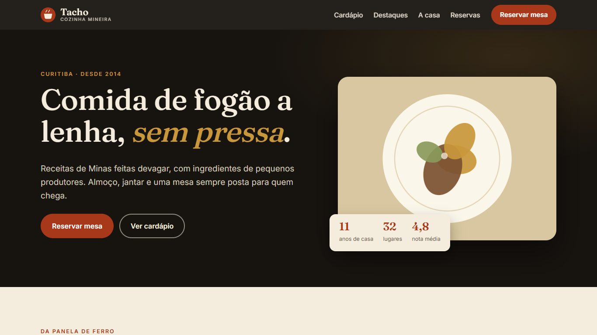
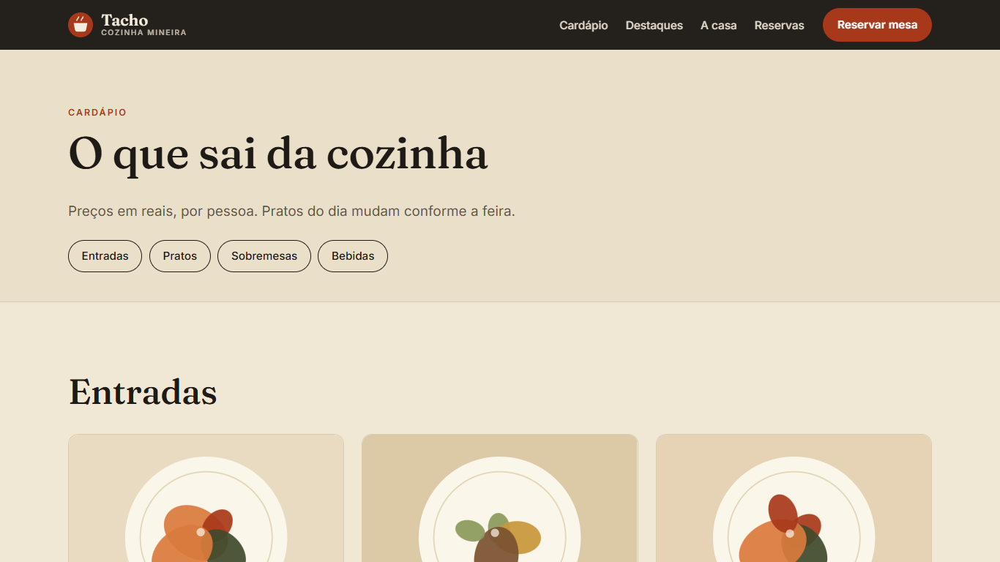
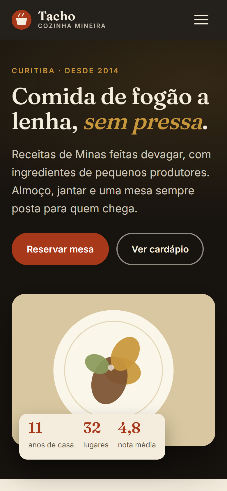

# Tacho Cozinha — custom WordPress theme

A hand-built WordPress theme for **Tacho**, a fictional Minas-style restaurant in Curitiba, Brazil. No page builder, no starter theme, no plugins required.



| Menu page | Mobile |
|---|---|
|  |  |

## What's inside

- **Classic PHP theme**: `header.php`, `footer.php`, `front-page.php`, `archive-prato.php`, `single-prato.php`, `page.php`, `404.php`, `index.php`.
- **Menu as content**: custom post type `prato` (dish) with a hierarchical `secao` taxonomy (Starters, Mains, Desserts, Drinks), price/tag/featured meta boxes (nonce + capability checks) and REST support.
- **Table bookings**: validated form (`admin-post.php`) with nonce, honeypot and server-side rules (name, phone, date within 90 days, fixed time slots, 1–12 guests). Valid requests are stored as a private `reserva` post type that only appears in the admin, and e-mailed to the site owner.
- **`theme.json` v3**: palette, self-hosted variable fonts (Fraunces + Inter), layout sizes.
- **Menus, widget area, Customizer** (phone, address, hours).
- Dish artwork is generated inline SVG, so there are no image files to license or optimise.
- Accessible by default: skip link, visible focus, AA contrast, `prefers-reduced-motion`, keyboard-friendly mobile menu. About 1 KB of JavaScript, no build step.

## Install

1. Download `tacho-cozinha.zip` from the project page.
2. WordPress admin → Appearance → Themes → Add New → Upload Theme → activate.
3. Add dishes under **Menu**, assign each to a **Section**, tick *Show on the home page* for up to three.
4. Settings → Permalinks → *Post name*, then Save (flushes the `/cardapio/` rewrite).
5. Appearance → Customize → *Restaurant* to edit phone, address and hours.

Requires WordPress 6.4+ and PHP 7.4+.

## Run it locally (no Docker, no MySQL)

Uses [WordPress Playground](https://wordpress.github.io/wordpress-playground/) and a blueprint that activates the theme and loads demo content (`blueprint/seed.php`):

```bash
cd tema
npx @wp-playground/cli server --port=9420 --blueprint blueprint/blueprint.json \
  --mount-dir ./tacho-cozinha /wordpress/wp-content/themes/tacho-cozinha \
  --mount-dir ./blueprint /wordpress/wp-content/tacho-bp
```

On Windows Git Bash, prefix with `MSYS_NO_PATHCONV=1`.

## Tests

HTTP smoke test (pages, menu counts, and every validation rule of the booking form) against a running site:

Needs a running WordPress with the theme active; the URL argument is required.

```bash
python tests/smoke.py http://127.0.0.1:9420
```

## Static demo

`estatico/` is a crawled copy of the running site with relative links, so it works on any static host (the live demo is served from GitHub Pages). The booking form is disabled there because there is no PHP behind it. The crawler is `export_static.py`.

## Structure

```
tema/tacho-cozinha/
  style.css  theme.json  functions.php
  header.php footer.php front-page.php index.php page.php 404.php
  archive-prato.php single-prato.php
  inc/            post-types.php  reservation.php
  template-parts/ hero historia reserva card-prato
  assets/         css/main.css  js/main.js  fonts/
```

Tacho is a fictional business; all names, prices and contact details are placeholders.
